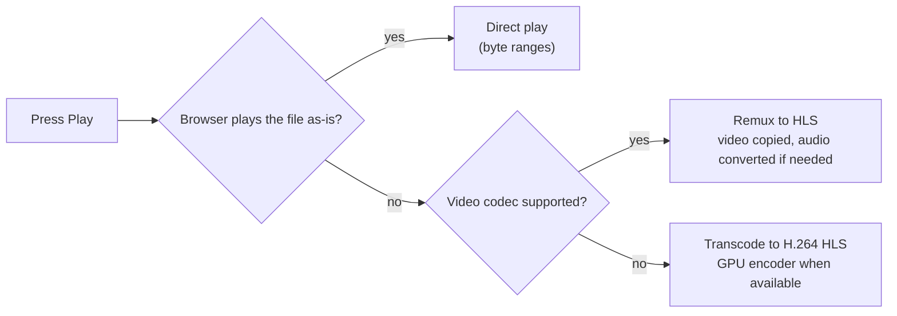

<p align="center">
  
</p>

<h1 align="center">Streamora</h1>

<p align="center">
  A self-hosted, Netflix-style media server for the movies and shows you already own.<br>
  Point it at your folders and get artwork, profiles, resume and smooth playback in any browser.
</p>

<p align="center">
  <a href="LICENSE"></a>
  
  
</p>

---

## Features

**Browse like a streaming service**
- Home page with a featured title and rows: Continue Watching, My List, Recently Added, New Releases, genres and Top Rated
- Movies and TV Shows pages with genre filters and sorting, plus search across titles, cast and genres
- Title pages with episodes by season, multiple versions (e.g. 4K and 1080p), cast and "More Like This"
- Works on desktop, tablet and phone, and can be added to a phone's home screen

**Profiles for the whole household**
- Several profiles, each with its own watch progress, My List and preferences, plus an optional PIN
- Kids profiles only see family ratings (G, PG, TV-Y, TV-G, U, …), and unrated titles stay hidden
- Per-profile audio language, subtitle language and style, and autoplay of the next episode

**Plays almost anything**
- **Direct play** when the browser supports the file, with seeking via HTTP range requests
- **Remux to HLS** when only the container is the problem (e.g. MKV with H.264): the video is copied, not re-encoded
- **Transcode** when needed, using hardware encoders when available (NVIDIA NVENC, Intel Quick Sync, VAAPI, Apple VideoToolbox) and falling back to software x264
- Switch audio track, subtitles, quality or version without losing your place; resume where you left off; next-episode countdown; keyboard shortcuts

**Library management**
- Movies and TV libraries with Plex/Jellyfin-style naming, which also copes with messy release names
- Picks up new files automatically through file watching and scheduled scans, and lists unreadable files
- Admin pages for libraries (with a folder picker), plugins, active streams, scans and profiles
- **Fix match** for titles that were identified wrongly, plus metadata locking

**Extensible with plugins**
- Metadata, subtitle and post-scan plugins written in TypeScript and loaded with hot reload
- Settings forms are generated from the plugin's manifest; network access is limited to declared hosts
- Ships with **TMDB** metadata, **local NFO and artwork** for fully offline libraries, and a **subtitle manager**

## Requirements

| | |
|---|---|
| **Node.js** | 20.19 or newer, with npm 10 or newer. npm 9 fails on workspace installs; `npx npm@11 install` works around it. |
| **FFmpeg** | `ffmpeg` and `ffprobe` on your `PATH`, or set `FFMPEG_PATH` / `FFPROBE_PATH`. Download from [ffmpeg.org](https://ffmpeg.org/download.html). |
| **TMDB API key** | Optional but recommended, for posters, backdrops, cast and ratings. It's free: [themoviedb.org → Settings → API](https://www.themoviedb.org/settings/api). |

Runs on Windows, macOS and Linux.

## Quick start

```bash
git clone https://github.com/santoshban/streamora.git
cd streamora
npm install

# Optional: add your TMDB key (TMDB_API_KEY=...) and adjust settings
cp .env.example .env

npm run dev
```

Open **http://localhost:5173**, then:

1. Create the first profile. It becomes the admin.
2. Go to **Admin → Libraries → Add library**, choose *Movies* or *TV Shows*, and pick your folder.
3. The first scan starts immediately. Titles appear as they are identified.

You can also enter the TMDB key later in **Admin → Plugins → TMDB Metadata**.

### Running it permanently

```bash
npm run build
npm start
```

The server then hosts the web UI itself on **http://localhost:8484**, so other devices on your network can use `http://<your-computer's-ip>:8484`. Set `NODE_ENV=production` in `.env` for a production install.

## Organising your media

Streamora understands the common Plex/Jellyfin conventions. Folders per title work best, but loose files with release-style names are fine too.

```text
Movies/
├── Heat (1995)/
│   ├── Heat (1995) - 1080p.mkv
│   ├── Heat (1995) - 4K.mkv          ← two files of one movie: shown as versions
│   ├── Heat (1995) - 1080p.en.srt
│   └── poster.jpg                    ← optional local artwork
└── Arrival.2016.1080p.WEB-DL.mkv     ← loose release names work too

TV Shows/
└── Breaking Bad (2008)/
    ├── Season 01/
    │   ├── Breaking Bad - S01E01 - Pilot.mkv
    │   └── Breaking Bad - S01E02.mkv
    └── Season 02/
        └── Breaking.Bad.S02E01.720p.HDTV.x264-GRP.mkv
```

- **Exact matches:** add an id tag to a folder or file name, such as `Heat (1995) {tmdb-949}` or `[imdbid-tt0113277]`.
- **Extras:** `Trailers/`, `Featurettes/`, `Extras/`, `Sample/` folders and files ending in `-trailer`, `-featurette`, … are skipped.
- **Skip a folder:** put an empty `.streamoraignore` (or `.nomedia` / `.plexignore`) file in it.
- **Subtitles:** `.srt`, `.ass`, `.ssa` and `.vtt` files next to the video or in a `Subs/` folder, plus text subtitles embedded in the file.
- **Offline metadata:** Kodi/Plex `.nfo` files plus `poster.jpg`, `fanart.jpg` and `clearlogo.png` are read before anything is fetched online.

Supported containers: MKV, MP4/M4V, MOV, AVI, WMV, WebM, TS/M2TS, MPEG, FLV, OGV, 3GP, DivX and ASF.

## Configuration

Every setting is optional. Copy `.env.example` to `.env` in the project root; it documents each value. The ones you are most likely to change:

| Variable | Default | What it does |
|---|---|---|
| `PORT` | `8484` | Port of the API server and of the built web UI. |
| `DATA_DIR` | `./data` | Where the database, artwork cache, plugin data and transcodes live. |
| `TMDB_API_KEY` | – | Seeds the TMDB plugin's key. A value saved in Admin → Plugins takes priority. |
| `HW_ACCEL` | `auto` | Video encoder: `auto`, `nvenc`, `qsv`, `vaapi`, `videotoolbox` or `none` (software). `auto` test-encodes and picks the first that works. |
| `MAX_TRANSCODE_SESSIONS` | `3` | Simultaneous transcodes. Remuxes, which are much cheaper, may use four times this. |
| `TRANSCODE_DIR` | `$DATA_DIR/transcodes` | Scratch space for streaming segments. Put it on a fast disk. |
| `SCAN_ON_STARTUP` | `true` | Rescan all libraries at start. Unchanged files are only checked, not re-read. |
| `SCAN_INTERVAL_MINUTES` | `360` | Periodic full scan. `0` turns it off; file watching still catches changes. |
| `SCAN_WATCH_POLLING` | `false` | Turn on for network shares (SMB/NFS), where file-change events don't arrive. |
| `SESSION_SECRET` | random | Signs login cookies. Generated once and kept in `$DATA_DIR/.session-secret` if empty. |
| `CORS_ORIGINS` | `http://localhost:5173` | Browser origins allowed to call the API during development. |

## Playback

Before each play, the browser reports which formats it can decode, and the server picks the cheapest way to play the file:



You can seek to any point in every mode. Streaming segments are produced on demand around the playhead, and idle sessions are stopped after a couple of minutes.

**Keyboard shortcuts in the player**

| Key | Action |
|---|---|
| `Space` / `K` | Play / pause |
| `←` / `J` and `→` / `L` | Back / forward 10 seconds |
| `↑` / `↓` | Volume |
| `M` | Mute |
| `F` | Fullscreen |
| `Esc` | Close panel, or leave the player |

## Plugins

Plugins live in `plugins/<plugin-id>/`. Each is a folder with a `manifest.json` and a TypeScript (or JavaScript) entry file. They are bundled on the fly with esbuild, so there's no build step, and they reload automatically when you edit them. Folders starting with `_` or `.` are ignored.

| Bundled plugin | Capability | What it does |
|---|---|---|
| `tmdb-metadata` | metadata | Posters, textless backdrops, title logos, synopses, genres, ratings, age certifications, cast and episode data from TMDB |
| `local-nfo-agent` | metadata | Reads `.nfo` files and local artwork first, and passes ids to online agents |
| `subtitle-manager` | subtitles, post_scan | Finds sidecar and embedded text subtitles, converts them to WebVTT, and can pre-extract after scans |

### Capabilities

| Capability | Instance property | Used for |
|---|---|---|
| `metadata` | `metadata.match()`, `getSeason()`, `search()` | Identifying titles, season and episode details, and the Fix match search |
| `subtitles` | `subtitles.discover()`, `render()`, `search()`, `download()` | Finding subtitle tracks and converting them to WebVTT |
| `post_scan` | `postScan.onScanComplete()` | Work after each library scan |
| `stream_resolver` | `streamResolver.resolve()` | Extra playback sources. Loaded, but not used by the player yet. |

Metadata providers run in `priority` order (lower first), and each sees what earlier providers found.

### A minimal plugin

`plugins/my-metadata/manifest.json`

```json
{
  "id": "my-metadata",
  "name": "My Metadata",
  "version": "1.0.0",
  "apiVersion": 1,
  "main": "index.ts",
  "capabilities": ["metadata"],
  "priority": 60,
  "permissions": { "network": ["api.example.com"] },
  "rateLimit": { "requests": 10, "intervalMs": 1000 },
  "settings": [
    { "key": "apiKey", "type": "secret", "label": "API key", "required": true, "env": "MY_METADATA_KEY" }
  ]
}
```

`plugins/my-metadata/index.ts`

```ts
import type { PluginFactory } from '@streamora/plugin-sdk';

interface SearchResponse {
  results: Array<{ id: string; title: string; year: number; summary: string; posterUrl: string }>;
}

const createPlugin: PluginFactory = (ctx) => ({
  metadata: {
    async match(request, { signal }) {
      const data = await ctx.http.getJson<SearchResponse>('https://api.example.com/search', {
        query: { q: request.title, year: request.year, key: String(ctx.settings.apiKey) },
        signal,
      });
      const hit = data.results[0];
      if (!hit) return null;
      return {
        kind: request.kind,
        title: hit.title,
        year: hit.year,
        overview: hit.summary,
        artwork: { poster: hit.posterUrl },
        externalIds: { example: hit.id },
        confidence: 0.8,
      };
    },
  },
});

export default createPlugin;
```

The `ctx` object passed to the factory provides:
- `settings`: resolved values, in priority order saved value → environment variable → manifest default
- `http`: a fetch client limited to the hosts in `permissions.network`, with rate limiting, retries and timeouts
- `cache`: a per-plugin key-value cache
- `fs`: read-only access to library folders (needs `"filesystem": "library-read"`) and a private data folder
- `ffmpeg`: runs ffmpeg or ffprobe (needs `"ffmpeg": true`)
- `log` and `signal`

Setting types (`string`, `secret`, `url`, `number`, `boolean`, `select`, `list`, `headers`) become a form in **Admin → Plugins**. A **Test** button there calls the plugin's optional `healthCheck()`. All types are in [`packages/plugin-sdk`](packages/plugin-sdk).

> **Note:** plugins run inside the server process. The permission system controls what `ctx` allows, but it is not a security sandbox, so only install plugins you trust.

## Development

```bash
npm run dev          # API with auto-restart (:8484) + Vite dev server (:5173)
npm test             # Vitest. Streaming tests need ffmpeg on the PATH.
npm run typecheck    # Type-check every package
npm run build        # Build web UI and server
npm run db:generate  # Create a migration after editing backend/src/db/schema.ts
```

```text
streamora/
├── backend/               Fastify API: scanner, catalog, streaming engine, plugin host
│   ├── src/
│   ├── drizzle/           SQL migrations (applied automatically at start)
│   └── test/
├── frontend/              React 19 + Vite + Tailwind CSS web UI
├── packages/plugin-sdk/   Type definitions for plugin authors
├── plugins/               Bundled plugins
└── data/                  Created at runtime, git-ignored: database, caches, transcodes
```

**Stack:** TypeScript, Fastify, SQLite (better-sqlite3 + Drizzle ORM), React, Vite, Tailwind CSS, hls.js, FFmpeg, esbuild and chokidar.

## Roadmap

- [ ] Docker image and `docker-compose.yml`
- [ ] Plugin template (`plugins/_template-plugin`)
- [ ] Copy HEVC into HLS (fMP4 segments) instead of transcoding it
- [ ] Image-based subtitles (PGS / VobSub), by burning them in
- [ ] Use `stream_resolver` plugins in the player

## Security

Streamora is designed for a trusted home network. Profile PINs keep children out of other profiles and admin pages, but they are not internet-grade authentication. If you want to reach it from outside your home, put it behind a VPN, or behind a reverse proxy with HTTPS and its own login.

## Legal

Streamora doesn't provide, host or link to any content. It organises and plays media files that you own or have the right to use.

Metadata and artwork come from [The Movie Database (TMDB)](https://www.themoviedb.org/). This product uses the TMDB API but is not endorsed or certified by TMDB.

Streamora is an independent project and is not affiliated with Netflix, Plex, Jellyfin or Kodi.

## License

[MIT](LICENSE)
